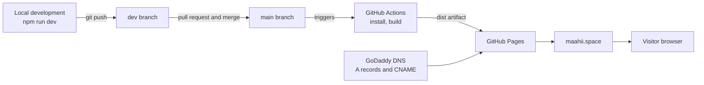

<div align="center">

# Mahieshwar Budati

### AI Engineer · LLM · NLP · RAG Systems

I build retrieval-augmented generation systems, live voice agents and the ML workflow pipelines that serve them.

**[maahii.space](https://maahii.space)** · [LinkedIn](https://www.linkedin.com/in/mahi-budati1209) · [GitHub](https://github.com/maahii-in) · [Email](mailto:mahieshwar.budati@gmail.com)

[](https://github.com/maahii-in/maahii-in.github.io/actions/workflows/deploy.yml)
[](https://github.com/maahii-in/maahii-in.github.io/releases)


</div>

<!-- Add a screenshot: save it as docs/preview.png and uncomment the next line.
<p align="center"></p>
-->

---

## Table of Contents

- [About](#about)
- [Professional Snapshot](#professional-snapshot)
- [Featured Projects](#featured-projects)
- [Features](#features)
- [Architecture](#architecture)
- [Tech Stack](#tech-stack)
- [Project Structure](#project-structure)
- [Getting Started](#getting-started)
- [Customizing the Content](#customizing-the-content)
- [Branching and Releases](#branching-and-releases)
- [Deployment and CI/CD](#deployment-and-cicd)
- [SEO and Discoverability](#seo-and-discoverability)
- [Design Decisions](#design-decisions)
- [Roadmap](#roadmap)
- [Acknowledgements](#acknowledgements)
- [Contact](#contact)

---

## About

I am an AI Engineer and Machine Learning enthusiast with hands-on experience building NLP and Large Language Model (LLM) applications. I work with Python, LangChain, FastAPI and vector databases to build Retrieval-Augmented Generation (RAG) systems and scalable AI solutions.

This repository is the source of my personal portfolio at **[maahii.space](https://maahii.space)**. It is a single-page React application that presents my experience, projects, skills and certifications, and it is deployed automatically from this repository.

## Professional Snapshot

| | |
| --- | --- |
| **Role** | AI Engineer at XaasIO Pvt Ltd (remote), Dec 2025 to present |
| **Focus** | RAG systems, LLM applications, voice agents, ML workflow automation |
| **Education** | B.Tech in Information Technology, Chirala Engineering College (JNTU Kakinada), CGPA 8.0 / 10 |
| **Location** | Chirala, Andhra Pradesh, India |

**What I do day to day**

- Build AI/ML workflow automation pipelines with Kubeflow and MLflow for model tracking and orchestration
- Develop RAG-based retrieval systems, including a live voice agent and a document-insight chatbot
- Integrate Milvus, LangGraph and vLLM for vector search, workflow orchestration and efficient model serving
- Manage deployment environments with Linux, Docker and Git

**Core skills**

| Area | Technologies |
| --- | --- |
| Languages and databases | Python, JavaScript, HTML5, CSS, SQL (MySQL), Milvus |
| AI and LLM | NLP, LLMs, RAG, LangChain, LangGraph, vLLM, FastAPI, AI workflow pipelines |
| Machine learning | Scikit-learn, TensorFlow, PyTorch, CNN, GAN |
| MLOps and tools | Kubeflow, MLflow, Docker, Linux, Git, GitHub, Jupyter, Google Colab |

**Certifications:** Oracle OCI AI Foundations and OCI Generative AI · Microsoft Azure Fundamentals · Infosys Big Data 101, 201, 301 · Generative AI workshops at IIT Hyderabad and IIT Madras

## Featured Projects

| Project | What it does | Stack |
| --- | --- | --- |
| [**Real-Time AI Voice Agent**](https://github.com/maahii-in/javis-live-voice-agent) | Low-latency conversational agent. An STT/TTS pipeline connects to an LLM backend for multi-turn voice conversations, using the LiveKit Agents framework for room and track management. | Python, LiveKit, STT/TTS, LLM |
| [**RAG AI System**](https://github.com/maahii-in/Basic-Advance-RAG) | Context-aware question answering over document datasets, with data pipelines for chunking, embedding generation and semantic similarity search. | Python, LangChain, Vector Search |
| [**Suicidal Tendencies Detection Model**](https://github.com/maahii-in/suicidal-tendency-report) | NLP-based classifier that detects suicidal tendencies in text data, with preprocessing and model training. | Python, Pandas, Scikit-learn, NLP |

## Features

**Experience**
- Single-page layout with smooth section navigation and a floating dock
- Animated hero with a name animation, typewriter roles and a neural-network particle background
- Light and dark themes
- Global search dialog for jumping to sections and projects
- Resume download, custom cursor, click effects and a full-screen mode
- Responsive from phones to desktops

**Content**
- Skills, experience, education, projects and certifications sections driven by typed data in one file
- Dedicated page listing all projects
- Contact section with email, LinkedIn, GitHub and an embedded map

**Engineering**
- TypeScript throughout, with a strict compiler configuration
- Production builds with Vite, with automatic deployment on every push to `main`
- SEO setup with structured data, Open Graph tags, `robots.txt` and a sitemap
- Versioned releases with a maintained [changelog](CHANGELOG.md)

## Architecture



The site is a static single-page application. There is no backend, database or secret to manage, so the contact form opens the visitor's email client with the message pre-filled instead of posting to a server.

## Tech Stack

| Layer | Tools |
| --- | --- |
| Framework | React 18, TypeScript 5 |
| Build | Vite 5 |
| Styling | Tailwind CSS 3, PostCSS, Autoprefixer |
| Animation and effects | Framer Motion, tsParticles, canvas-confetti |
| Routing | React Router |
| Icons | Lucide, React Icons, Heroicons |
| Quality | ESLint, TypeScript compiler |
| Hosting and CI/CD | GitHub Pages, GitHub Actions |
| Domain | Custom domain through GoDaddy DNS |

## Project Structure

```
.
├── .github/workflows/deploy.yml    # Build and deploy to GitHub Pages
├── public/
│   ├── documents/resume.pdf        # Downloadable resume
│   ├── img/                        # Profile photo, certificates, project covers
│   ├── CNAME                       # Custom domain
│   ├── robots.txt
│   └── sitemap.xml
├── src/
│   ├── components/                 # Hero, Skills, Experience, Projects, Contact, ...
│   ├── data/PortfolioData.ts       # Projects, experience, education, certifications
│   ├── hooks/                      # Active section, theme, mouse position
│   ├── lib/                        # Utilities
│   ├── types/                      # Shared TypeScript types
│   ├── App.tsx
│   └── main.tsx
├── CHANGELOG.md                    # Release history
├── index.html                      # SEO tags and structured data
├── tailwind.config.js
├── tsconfig.app.json
└── vite.config.ts
```

## Getting Started

**Prerequisites:** Node.js 18 or newer and npm.

```bash
# Clone the repository
git clone https://github.com/maahii-in/maahii-in.github.io.git
cd maahii-in.github.io

# Install dependencies
npm install --legacy-peer-deps

# Start the development server
npm run dev
```

The site runs at `http://localhost:3000`. No environment variables are required.

| Command | Description |
| --- | --- |
| `npm run dev` | Start the development server with hot reload |
| `npm run build` | Create an optimized production build in `dist/` |
| `npm run preview` | Preview the production build locally |
| `npm run lint` | Run ESLint |

## Customizing the Content

| What to change | Where |
| --- | --- |
| Projects, experience, education, certifications | `src/data/PortfolioData.ts` |
| Skills and logo strip | `src/components/Skills.tsx`, `src/components/SkillLogosScroll.tsx` |
| Hero text, links, name and roles | `src/components/Hero.tsx`, `NameAnimation.tsx`, `TypeWriter.tsx` |
| Contact details and map | `src/components/Contact.tsx` |
| Resume | `public/documents/resume.pdf` |
| Profile photo | `public/img/me.jpg` |
| Certificate images | `public/img/` and the paths in `PortfolioData.ts` |
| SEO tags and structured data | `index.html`, `public/robots.txt`, `public/sitemap.xml` |

## Branching and Releases

| Branch | Purpose |
| --- | --- |
| `main` | Production. Every push is built and deployed to [maahii.space](https://maahii.space). |
| `dev` | Day-to-day work. Pushes here do not change the live site. |

**Workflow**

1. Work on `dev` and check changes locally with `npm run dev`.
2. Commit and push to `dev`.
3. When the changes are ready, open a pull request from `dev` into `main` and merge it.
4. The merge triggers the deployment workflow and the live site updates.
5. Update [CHANGELOG.md](CHANGELOG.md), then tag the release:

```bash
git checkout main
git pull origin main
git tag -a v1.1.0 -m "Describe the release"
git push origin v1.1.0
```

Releases follow [Semantic Versioning](https://semver.org/) and are listed on the [Releases](https://github.com/maahii-in/maahii-in.github.io/releases) page. The first release is `v1.0.0`.

## Deployment and CI/CD

Every push to `main` runs the workflow in `.github/workflows/deploy.yml`:

1. Check out the code and set up Node.js 20
2. Install dependencies and run `npm run build`
3. Copy `index.html` to `404.html` so deep links such as `/all-projects` work on refresh
4. Upload the `dist` folder and publish it to GitHub Pages

**One-time setup**

1. In **Settings, Pages**, set **Source** to **GitHub Actions**.
2. Add DNS records at your registrar: four `A` records for `@` pointing to GitHub Pages (`185.199.108.153`, `185.199.109.153`, `185.199.110.153`, `185.199.111.153`) and a `CNAME` for `www` pointing to `maahii-in.github.io`.
3. Put the domain in `public/CNAME` and enter it under **Settings, Pages, Custom domain**.
4. Enable **Enforce HTTPS** once GitHub issues the certificate.

## SEO and Discoverability

- Title, description, canonical URL and Open Graph tags in `index.html`
- `Person` structured data (JSON-LD) linking the site to my GitHub and LinkedIn profiles
- `robots.txt` and `sitemap.xml` served from the site root
- Domain ownership verified in Google Search Console

## Design Decisions

- **Static hosting over a server.** A portfolio has no dynamic data, so a static build on GitHub Pages is free, fast and has nothing to maintain or secure.
- **All content in one typed data file.** Projects, experience, education and certifications live in `PortfolioData.ts`, so updating the site means editing data, not components.
- **Mail-client contact form.** Without a backend there are no API keys or spam endpoints to protect. The form builds a `mailto:` link with the visitor's message.
- **404 fallback for client-side routes.** GitHub Pages has no server-side routing, so the build copies `index.html` to `404.html` to keep deep links working.
- **Separate production and working branches.** Deploying only from `main` means experiments on `dev` can never break the live site.

## Roadmap

- [x] Version 1: portfolio content, custom domain, SEO and automated deployment
- [ ] Add screenshots and live demos for each project
- [ ] Replace placeholder certificate cards with the real certificates
- [ ] Add a blog section for write-ups on RAG and LLM engineering
- [ ] Add a case study page for each featured project

## Acknowledgements

This site started from an open-source React portfolio template by [chinni-d](https://github.com/chinni-d/portfolio_website) and has been rebuilt around my own content, data, projects and deployment setup. Thanks to the authors of the open-source libraries it depends on.

## Contact

| | |
| --- | --- |
| Website | [maahii.space](https://maahii.space) |
| Email | [mahieshwar.budati@gmail.com](mailto:mahieshwar.budati@gmail.com) |
| LinkedIn | [mahi-budati1209](https://www.linkedin.com/in/mahi-budati1209) |
| GitHub | [maahii-in](https://github.com/maahii-in) |
| Location | Chirala, Andhra Pradesh, India |

<div align="center">

---

Built by **Mahieshwar Budati**

</div>
